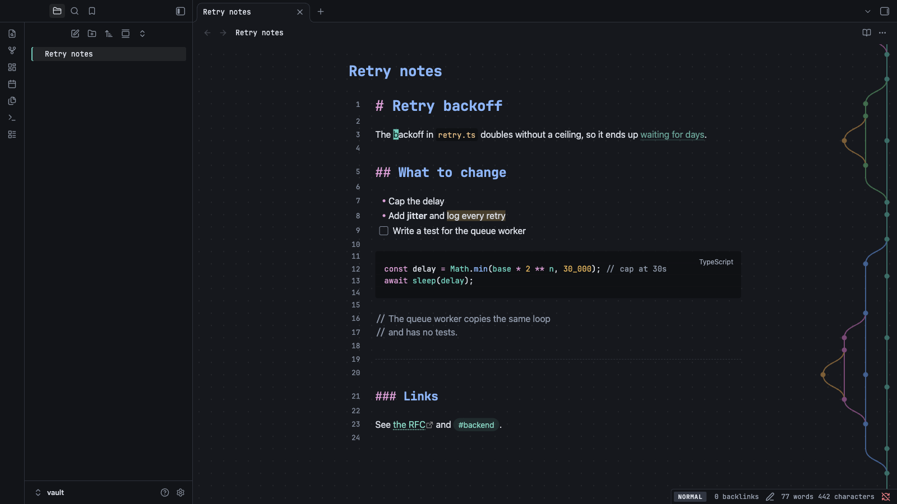

# Scratch Buffer

Your vault as an open editor buffer. Scratch Buffer is a light and dark Obsidian theme for people who live in their editor.

## What it does

- **Markdown reads like source.** Headings keep their `#` markers. Inline code is coloured like a string, quotes read as `//` comments, and links get a dotted underline.
- **A git graph runs down the margin**, with whitespace dots behind it, in the same colours as the syntax.
- **A Vim mode chip sits in the status bar.** With Vim key bindings on, it shows `NORMAL`, `INSERT` or `VISUAL`. Without Vim, it shows `INSERT` while you're typing in a note.
- **Monospace interface.** The file tree, tabs, headings and line numbers use [JetBrains Mono](https://www.jetbrains.com/lp/mono/) if you have it installed, then your system monospace font. Note text keeps your normal text font.

## Tips

- Turn on **Settings → Editor → Show line number** to get the line-number gutter.
- Turn on **Settings → Editor → Vim key bindings** so the status chip follows your real Vim mode.

## Install

Open **Settings → Appearance → Themes → Manage**, search for "Scratch Buffer" and choose **Use**.

To install by hand, copy `manifest.json` and `theme.css` into `<your vault>/.obsidian/themes/Scratch Buffer/`, then choose the theme in **Settings → Appearance**.

## Also available

Scratch Buffer started as a theme for T3 Code.

## License

[MIT](LICENSE)
