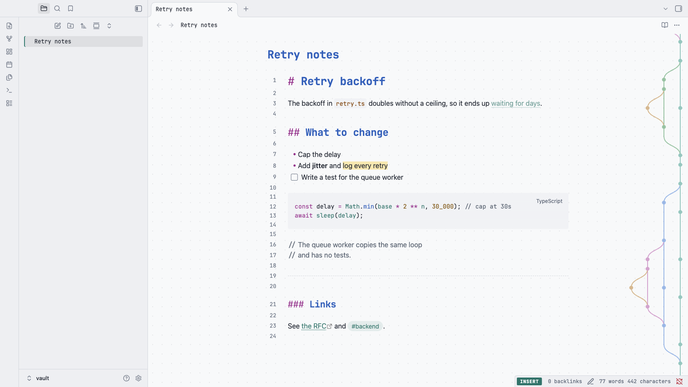

# Scratch Buffer

Your vault as an open editor buffer. Scratch Buffer is a light and dark Obsidian theme for people who live in their editor.

## What it does

- **Markdown reads like source.** Headings keep their `#` markers. Inline code is coloured like a string, quotes read as `//` comments, and links get a dotted underline.
- **A git graph runs down the margin**, with whitespace dots behind it, in the same colours as the syntax.
- **A Vim mode chip sits in the corner of the note you're editing**, like a Vim mode line. With Vim key bindings on, it shows `NORMAL`, `INSERT` or `VISUAL`. Without Vim, it shows `INSERT` while you're typing.
- **Monospace interface.** The whole interface, plus headings and line numbers, uses [JetBrains Mono](https://www.jetbrains.com/lp/mono/) if you have it installed, then your system monospace font. Note text keeps your normal text font. Fonts you set in **Settings → Appearance** still take priority.

## What it changes in Obsidian

So nothing comes as a surprise, here is everything the theme overrides.

**Fonts**

| Where | Font |
|---|---|
| Interface: sidebars, tabs, menus, status bar | JetBrains Mono, then SF Mono, then your system monospace |
| Headings and the note title | The same monospace font |
| Code, inline code and line numbers | The same monospace font |
| Note text | Unchanged: your text font, or Obsidian's default |

Fonts you choose in **Settings → Appearance** (interface font, text font, monospace font) always take priority over the theme. To let the theme pick, leave those empty.

JetBrains Mono isn't bundled with the theme, to keep it small. [Install it](https://www.jetbrains.com/lp/mono/) for the intended look; without it you get SF Mono or your system's monospace font.

**Colours**

- Its own palette for light and dark: background, sidebars, text, borders and the teal accent colour.
- The red, orange, yellow, green, cyan, blue, purple and pink that Obsidian and plugins use.
- Syntax colours in code blocks, plus headings, list bullets, quotes, highlights and text selection.

**Note styling**

- Headings show their `#` markers in reading view and in Live Preview.
- Quotes use `//` markers instead of a left border, in italic comment colour.
- Inline code is coloured like a string.
- Links use a dotted underline instead of a solid one.
- Horizontal rules are dashed.
- Corners are slightly tighter.

**Additions**

- A git graph and a dot grid behind every note. They are background images, so they don't affect text or layout.
- The Vim mode chip in the bottom-left corner of the note you're editing.
- The active file in the file tree gets an accent mark on its left edge.
- In Vim's Visual mode, the editor's second cursor layer stays on screen but hidden, so the chip can sit on it.

The theme doesn't change your settings or notes, and it adds no plugins. Switch to another theme and everything goes back.

## Tips

- Turn on **Settings → Editor → Show line number** to get the line-number gutter.
- Turn on **Settings → Editor → Vim key bindings** so the mode chip follows your real Vim mode.

## Install

Open **Settings → Appearance → Themes → Manage**, search for "Scratch Buffer" and choose **Use**.

To install by hand, copy `manifest.json` and `theme.css` into `<your vault>/.obsidian/themes/Scratch Buffer/`, then choose the theme in **Settings → Appearance**.

## Also available

Scratch Buffer started as a theme for T3 Code.

## License

[MIT](LICENSE)
